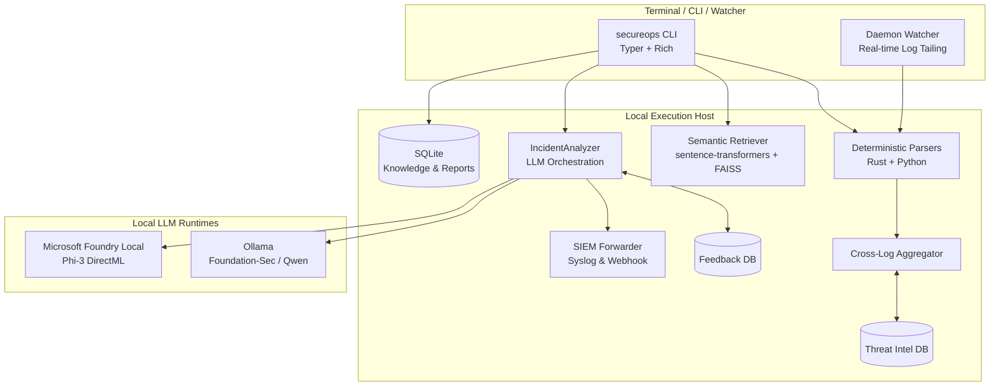

# SecureOps Local 🛡️

<div align="center">
  <p><strong>An air-gapped incident-review decision-support system for Linux SSH, Windows Event, Nginx, and AWS logs, powered by local LLM inference, high-performance Rust parsing, multi-source correlation, and document-grounded RAG.</strong></p>

  [](https://www.python.org/downloads/)
  [](https://www.rust-lang.org/)
  [](https://typer.tiangolo.com)
  [](https://fastapi.tiangolo.com)
  [](https://www.sqlite.org)
</div>

---

## 📖 Table of Contents

- [Overview](#-overview)
- [Why SecureOps Local?](#-why-secureops-local)
- [Enterprise Features (v1.1)](#-enterprise-features-v11)
  - [🦀 High-Performance Rust Engine](#-high-performance-rust-engine)
  - [🧠 Cross-Log Correlation](#-cross-log-correlation)
  - [🕵️ Offline Threat Intelligence](#️-offline-threat-intelligence)
  - [♻️ Autonomous Feedback Loop](#️-autonomous-feedback-loop)
- [Command Line Interface (CLI)](#-command-line-interface-cli)
  - [Incident Analysis & Correlation](#incident-analysis--correlation)
  - [Daemon Watcher Mode](#daemon-watcher-mode)
  - [Threat Intel Management](#threat-intel-management)
  - [Feedback Management](#feedback-management)
  - [Knowledge Base & RAG](#knowledge-base--rag)
- [Architecture & Pipeline](#-architecture--pipeline)
- [Model Candidates & Profiles](#-model-candidates--profiles)
- [Getting Started](#-getting-started)
- [Project Status](#-project-status)
- [Security & Privacy](#-security--privacy)

---

## 🌟 Overview

SecureOps Local is a **local-first, air-gapped-ready** tool that transforms raw, multi-source security logs into structured, cited incident-review reports — without ever sending a single byte to a cloud service.

Built specifically for **SOC analysts, system administrators, and privacy-conscious teams**, SecureOps Local follows the Unix philosophy and provides a native Python CLI with rich terminal formatting, background daemon monitoring, and automated SIEM forwarding.

### Scope

✅ **What it is:** A high-performance log-summarization tool, document-grounded decision-support CLI, threat intelligence correlator, and local deployment-profile evaluation platform.  
❌ **What it is NOT:** A cloud SIEM, IDS/IPS, antivirus, automated remediation system, or an active attack blocker.

---

## 🎯 Why SecureOps Local?

Pasting raw security logs into public cloud AI services violates privacy, leaks credentials, and suffers from hallucinations. SecureOps Local solves this through strict local guarantees:

1. **Deterministic Constraints:** A strict Python (and Rust) parser computes all mathematical facts (counts, IPs, timestamps). The LLM is strictly prohibited from inventing parser numbers.
2. **Air-Gapped Privacy:** Zero cloud LLM fallback. All model inference, threat intelligence matching, and RAG search execute locally on host hardware.
3. **Document-Grounded RAG:** The LLM reasons only over retrieved chunks from audited security literature.
4. **Strict Structured Output:** Responses must strictly conform to the `ModelAssessment` JSON schema. Reasoning traces (`<think>`) are scrubbed before presentation.

---

## 🏢 Enterprise Features (v1.1)

SecureOps Local includes a suite of advanced enterprise features introduced in v1.1, elevating it from a simple log parser to a comprehensive analysis engine.

### 🦀 High-Performance Rust Engine
Parsing gigabytes of security logs requires speed. SecureOps Local utilizes a native Rust extension (`secureops_core` via PyO3/maturin) to handle regex and string matching at near-C speeds. 
* **Safe Fallback:** If the Rust toolchain is missing or compilation fails, the system safely falls back to a 100% compatible pure Python implementation.

### 🧠 Cross-Log Correlation
Security incidents rarely happen in isolation. The `CrossLogAggregator` deterministically merges heterogeneous logs (e.g., Nginx web access, Windows Event Logs, SSH auth logs) into a unified, chronological timeline grouped by Source IP. The LLM can then evaluate the risk of multi-stage attacks (e.g., Web reconnaissance followed by SSH brute-forcing).

### 🕵️ Offline Threat Intelligence (IOCs)
Integrate massive STIX, MISP, CSV, and JSON threat feeds into a local SQLite database (`threat_intel`). As logs are parsed, IP addresses are checked against this database with **zero network requests**, preserving strict air-gapped guarantees. Flagged IPs (e.g., `KNOWN_APT`, `TOR_NODE`) are dynamically injected into the LLM's system prompt for elevated risk scoring.

### ♻️ Autonomous Feedback Loop
SOC analysts can tag specific incident reports as false positives using the CLI. This feedback is securely stored in a local SQLite database. On subsequent analyses involving the same IP or user, the RAG engine automatically retrieves historical administrator context and injects it into the LLM's system prompt. This creates a self-improving system that reduces alert fatigue **without requiring any model fine-tuning or weight modification**.

---

## 🖥️ Command Line Interface (CLI)

SecureOps Local provides a comprehensive terminal CLI powered by `typer` and `rich`.

```bash
# View help and all available commands
python -m src.cli.main --help
```

### Incident Analysis & Correlation

Analyze one or multiple log files simultaneously to leverage Cross-Log Correlation:

```bash
# Basic single-file analysis
python -m src.cli.main analyze examples/demo_ssh_logs.log

# Multi-source correlation (SSH + Nginx) with JSON export
python -m src.cli.main analyze \
    -f /var/log/auth.log -t ssh \
    -f /var/log/nginx/access.log -t nginx \
    --output-json report.json

# Using a custom model profile (Microsoft Foundry Local)
python -m src.cli.main analyze /var/log/auth.log \
    --model Phi-3-mini-4k-instruct-onnx \
    --provider foundry \
    --base-url http://localhost:39251
```

### Daemon Watcher Mode

Monitor active log files in real-time. SecureOps Local will track changes using a sliding time-window and automatically trigger RAG/LLM analysis when threat thresholds are exceeded.

```bash
# Watch an SSH auth log and forward generated alerts to a local SIEM via RFC 5424 Syslog
python -m src.cli.main watch /var/log/auth.log --log-type ssh \
    --interval 60 \
    --forward-syslog 127.0.0.1:514
```

### Threat Intel Management

Manage your offline Indicator of Compromise (IOC) database:

```bash
# Ingest an offline STIX feed
python -m src.cli.main intel add /mnt/usb/misp_export.json --format stix

# Lookup a suspicious IP locally
python -m src.cli.main intel lookup 198.51.100.42
```

### Feedback Management

Train the system's RAG memory by flagging false positives:

```bash
# Flag a past incident as a false positive
python -m src.cli.main feedback inc_1a2b3c4d \
    --false-positive \
    --reason "Authorized vulnerability scanner from internal subnet."
```

### Knowledge Base & RAG

Manage local security guidance documents (NIST, CISA, MITRE ATT&CK) for RAG retrieval:

```bash
# Ingest a security guide
python -m src.cli.main knowledge add /path/to/NIST_SP_800-61r3.pdf

# List all indexed knowledge base documents
python -m src.cli.main knowledge list
```

---

## 🏗️ Architecture & Pipeline

### System Topology



### Deterministic AI Guarantee

SecureOps Local enforces a strict trust boundary:
- **Trusted (Parser & Database):** IP addresses, event counts, timelines, multi-source event correlation, Threat Intel flags, and Administrator Feedback.
- **Constrained (Model):** Summary of observed patterns, risk level (low/medium/high), evidence-based reasoning, defensive recommendations.

---

## 🧠 Model Candidates & Profiles

| Profile | Runtime | Model | Quantization | Role |
|---|---|---|---|---|
| **Foundation-Sec** | Ollama | `foundation-sec-8b-reasoning:q4_k_m` | Q4_K_M (GGUF) | Domain-specialized cybersecurity candidate (Default) |
| **Qwen** | Ollama | `qwen:0.5b` / `qwen3.5:9b` | Q4_K_M | Fast baseline reference |
| **Foundry** | Foundry Local | `Phi-3-mini-4k-instruct-onnx` | ONNX INT4 | Hardware-accelerated Windows candidate |

---

## 🚀 Getting Started

### Prerequisites
- **Python** 3.12+
- **Rust Toolchain** (Optional, for `secureops_core` compilation speedups)
- **Ollama** 0.32+ (For Foundation-Sec and Qwen)
- **Foundry Local** 0.10+ (Optional, for Microsoft model inference)

### Installation & Setup

1. **Clone the repository:**
   ```bash
   git clone https://github.com/husoelrey/SecureOpsLocal.git
   cd SecureOpsLocal
   ```

2. **Setup virtual environment:**
   ```bash
   python -m venv .venv
   .venv\Scripts\activate  # Windows
   # or: source .venv/bin/activate  # Linux/macOS
   ```

3. **Install dependencies:**
   ```bash
   pip install --upgrade pip
   pip install -r requirements.txt
   ```

4. **Install Rust Extension (Optional but Recommended):**
   ```bash
   # Requires `cargo` and `rustc` in PATH
   pip install maturin
   maturin develop
   ```

5. **Prepare Local Models (Ollama):**
   ```bash
   ollama pull qwen:0.5b
   # Or create the Foundation-Sec profile using your local GGUF
   ollama create foundation-sec-8b-reasoning:q4_k_m -f Modelfile
   ```

---

## 📊 Project Status

| Phase | Description | Status |
|---|---|---|
| **v1.0** | Native Typer & Rich Command Line Interface | ✅ Complete |
| **v1.0** | Semantic RAG (Vector Embeddings) | ✅ Complete |
| **v1.0** | Deployment-profile benchmark & LLM adapter selection | ✅ Complete |
| **v1.0** | SIEM Integrations (Syslog & Webhook) | ✅ Complete |
| **v1.1** | Multi-Source Parsers (SSH, Windows, Nginx, AWS) | ✅ Complete |
| **v1.1** | Daemon Watcher Mode & Alerting | ✅ Complete |
| **v1.1** | 🦀 High-Performance Rust Parsing Engine | ✅ Complete |
| **v1.1** | 🧠 Deterministic Cross-Log Correlation | ✅ Complete |
| **v1.1** | 🕵️ Offline Threat Intelligence DB | ✅ Complete |
| **v1.1** | ♻️ Autonomous Feedback Loop | ✅ Complete |

---

## 🔒 Security & Privacy

SecureOps Local processes sensitive security data and is built with strict, non-negotiable privacy guarantees:

- **No Cloud Fallback:** Data never leaves the local machine. There are zero API calls to external cloud LLM providers or Threat Intel databases.
- **No Raw Log Persistence:** Only hashes, sizes, and structured metadata are stored in SQLite. Raw incident data is ephemeral.
- **Privacy-Minimized Retrieval:** IP addresses and usernames are scrubbed from search queries before embedding generation.
- **Defensive Boundary:** The application does **not** execute commands, block addresses, or modify firewall rules. Recommendations are strictly limited to investigation and hardening.

---
*For more detailed architecture decisions and internal context, please refer to the `docs/context/` directory.*
