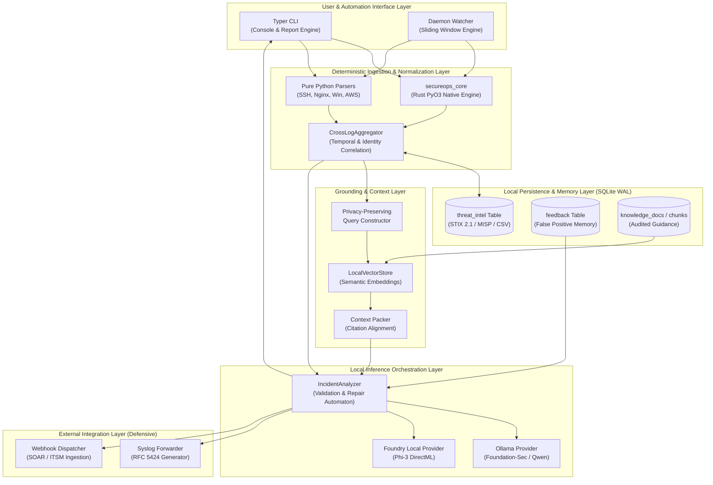

# SecureOps Local: Architecture, Engineering, and Operational Reference Manual
[](https://github.com/husoelrey/SecureOpsLocal/actions/workflows/ci.yml)

---

## 1. Executive Summary & Operational Scope

### 1.1 Core Mission & Product Identity

SecureOps Local is an air-gapped, local-first incident-review decision-support system (DSS) engineered to ingest, normalize, and analyze heterogeneous security logs (Linux SSH, Windows Security Event Logs, Nginx/Web Access, and AWS CloudTrail). Operating under strict computational isolation, the system extracts deterministic telemetry facts, queries local indicators of compromise (IOCs), retrieves relevant security doctrine from an offline knowledge base, and orchestrates on-premises Large Language Models (LLMs) to synthesize cautious, cited, and schema-compliant incident assessments.

The design philosophy prioritizes mathematical certitude, verifiable evidence chains, and non-destructive advisory capabilities over ungrounded generative speculation or autonomous operational intervention.

### 1.2 Explicit Non-Goals & Architectural Boundaries

To preserve strict alignment with enterprise safety and compliance standards, SecureOps Local defines unambiguous operational boundaries:

- **Not a Security Information and Event Management (SIEM) Platform:** SecureOps Local does not serve as an enterprise-wide event lake, distributed log warehouse, or long-term cold storage facility. It is a targeted triage and incident-synthesis engine.
- **Not an Intrusion Detection / Prevention System (IDS/IPS):** The software does not operate in-line on network packets, inspect kernel syscalls in real time, or generate raw signature alerts at the packet layer.
- **Not an Antivirus or Endpoint Detection and Response (EDR) Agent:** The platform does not inspect running process memory, inject drivers, or calculate binary hashes on endpoint filesystems.
- **Not an Active Blocking or Automated Remediation Engine:** Under no circumstance does the software autonomously modify firewall rules (e.g., `iptables`, `nftables`, Windows Firewall), terminate network connections, revoke credentials, or execute external operating system shell commands based on model generation.
- **No Cloud Fallback:** The core system architecture contains zero remote API fallbacks. Network sockets are strictly bound to local interfaces or explicitly configured local SIEM forwarders.

### 1.3 Defensive Posture & Human-in-the-Loop Decision Support

All generative assessments generated by SecureOps Local are advisory. The system enforces a **Human-in-the-Loop (HITL)** operational paradigm wherein:
1. Deterministic facts (timestamps, counts, IP addresses, attacked accounts, protocol signatures) are extracted via deterministic parsers and presented as immutable ground truth.
2. The language model generates risk hypotheses, tactical interpretations, and defensive hardening recommendations strictly grounded in vetted literature (such as NIST SP 800-61 Rev. 3, CISA alerts, MITRE ATT&CK techniques, and OWASP frameworks).
3. The human Security Operations Center (SOC) analyst or system administrator retains sole authority to validate conclusions, confirm threat veracity, and initiate manual remediation workflows.

---

## 2. System Architecture & Topology

SecureOps Local is implemented as a modular monolith adhering to inward-facing dependency inversion principles. Core domain contracts, deterministic parsers, and statistical aggregators remain completely decoupled from inference runtimes, database drivers, and CLI presentation layers.



### 2.1 Architectural Subsystems

1. **Presentation & Automation Layer (`src/cli/`, `src/watcher/`):**
   Provides a terminal interface via Typer and Rich. The CLI executes batch log analysis, offline threat intelligence ingestion, feedback recording, and knowledge base indexing. The Daemon Watcher maintains non-blocking, multi-file sliding windows over active security logs to trigger automated synthesis upon threshold breach.

2. **Parsing & Normalization Engine (`rust/`, `src/parser/`):**
   Transforms raw unstructured/semi-structured text, JSON, and EVTX lines into typed `ParsedLogLineCreate` entities. Utilizes a native Rust extension (`secureops_core`) with an automatic, 100% compliant pure Python fallback.

3. **Cross-Log Correlation Engine (`src/parser/aggregator.py`):**
   Aggregates parsed events across heterogeneous sources into an IP-centric, chronologically sorted timeline. Computes deterministic statistical metrics (exact success/failure counts, session durations, targeted accounts) and queries local threat intelligence.

4. **Offline Intelligence & Feedback Memory (`src/integrations/intel_feed.py`, `src/feedback/service.py`):**
   Interfaces with local SQLite tables. Ingests STIX 2.1 bundles, MISP feeds, and CSV datasets. Captures operator feedback (e.g., false positive annotations) and dynamically generates system prompt context to suppress repeated alert fatigue.

5. **Semantic Grounding Subsystem (`src/rag/`):**
   Implements document ingestion, heading-aware text chunking, local dense vector embedding generation, and cosine-similarity retrieval. Redacts IP addresses and usernames from search queries to prevent privacy leakage during retrieval.

6. **Inference & Validation Layer (`src/llm/`):**
   Encapsulates local LLM communication via abstract `LocalLLMProvider` contracts (supporting Ollama and Microsoft Foundry Local). Strips internal reasoning traces (e.g., `<think>` tokens), validates output against strict Pydantic JSON schemas, and manages bounded single-attempt repair routines.

7. **Defensive Integrations Layer (`src/integrations/`):**
   Constructs standard RFC 5424 Syslog payloads and formatted JSON webhooks to broadcast structured incident findings to external SIEM/SOAR platforms (e.g., Splunk, Elasticsearch, Jira, ServiceNow).

---

## 3. Pipeline & Multi-Source Correlation (v1.1)

### 3.1 Heterogeneous Log Normalization

Security incidents typically span multiple infrastructure layers. SecureOps Local normalizes four major security log formats into a unified data structure:

```python
class ParsedLogLineCreate(BaseModel):
    timestamp: datetime.datetime
    source_ip: Optional[str] = None
    user: Optional[str] = None
    event_type: str
    port: Optional[int] = None
    raw_content: str
    is_parsed: bool = True
```

#### Supported Log Sources & Detection Logic

| Source Type | Input Format Variants | Primary Extracted Entities | Attack Pattern & Event Taxonomy |
|---|---|---|---|
| **Linux SSH** | Syslog (RFC 3164), Journald / ISO-8601, OpenSSH daemon format | `timestamp`, `source_ip`, `user`, `port`, `auth_method` | `successful_login`, `failed_login`, `failed_login_invalid_user`, `invalid_user`, `connection_closed`, `disconnected` |
| **Windows Security** | Windows EVTX JSON exports, XML event wrappers, Structured Syslog text | `TimeCreated`, `IpAddress` / `SourceNetworkAddress`, `TargetUserName`, `IpPort`, `EventID` | `successful_login` (Event ID 4624), `failed_login` (Event ID 4625), `windows_event_<id>` |
| **Nginx Web Access** | Combined Log Format, Common Log Format, JSON access logs | `remote_addr`, `time_local`, `remote_user`, `request`, `status` | URL-decoded payload inspection: SQL Injection (`sqli_attempt`), Cross-Site Scripting (`xss_attempt`), Path Traversal (`path_traversal`), `unauthorized_access` (401), `forbidden_access` (403), `successful_request` (200/300) |
| **AWS CloudTrail** | CloudTrail JSON Envelopes (`{"Records": [...]}`), Single Event JSON, Syslog text | `eventTime`, `sourceIPAddress`, `userName` / `userIdentity.arn`, `eventName`, `responseElements.ConsoleLogin` | `successful_login` (`ConsoleLogin=Success`), `failed_login` (`ConsoleLogin=Failure` or `errorCode`), `aws_<eventName>` |

### 3.2 Web Attack Signature Detection in Nginx Logs

The Nginx parser inspects both raw and recursive URL-decoded query strings (`urllib.parse.unquote_plus`) to counter encoding evasion techniques. Detection rules target:

- **SQL Injection (SQLi):** `UNION SELECT`, `' OR '1'='1`, `SLEEP()`, `INFORMATION_SCHEMA`, `--`, `xp_cmdshell`.
- **Cross-Site Scripting (XSS):** `<script>`, `javascript:`, event handlers (`onerror=`, `onload=`), `document.cookie`, `eval()`.
- **Path Traversal / LFI:** `../`, `..\`, `/etc/passwd`, `/proc/self/environ`, `c:\windows\system32`, `boot.ini`.

### 3.3 Cross-Log Aggregation & Temporal Alignment

The `CrossLogAggregator` ingests heterogeneous event streams, strips unparsed artifacts, groups events by `source_ip`, and sorts them chronologically:

$$\forall \text{ IP } k, \quad E_k = [e_{k,1}, e_{k,2}, \dots, e_{k,n}] \quad \text{where } t(e_{k,i}) \le t(e_{k,i+1})$$

```python
# Multi-Source Correlation Timeline Generation
timeline = aggregator.get_multi_source_timeline()
# Structure: {
#   "198.51.100.42": [
#     {"timestamp": "2026-08-14T10:00:00Z", "event_type": "sqli_attempt", "raw_content": "...GET /search?id=1' UNION SELECT..."},
#     {"timestamp": "2026-08-14T10:05:22Z", "event_type": "failed_login", "user": "admin", "port": 22},
#     {"timestamp": "2026-08-14T10:08:11Z", "event_type": "successful_login", "user": "admin", "port": 22}
#   ]
# }
```

This multi-source correlation timeline exposes multi-stage attack progressions (e.g., initial web vulnerability scanning followed by SSH brute-force and privilege escalation) directly to the decision-support engine.

---

## 4. Native High-Performance Rust Parsing Engine (`secureops_core`)

### 4.1 PyO3 & Maturin Integration

For high-throughput log processing, SecureOps Local implements a compiled native extension (`secureops_core`) written in Rust using PyO3 and Maturin. The Rust engine executes regular expression parsing, timestamp normalization, and string tokenization at compiled native machine speed.

```
+-------------------------------------------------------------------+
|                           Python Runtime                          |
|  [SSHAuthLogParser]                   [NginxAccessParser]         |
+-------------------------------------------------------------------+
                                  |
                   PyO3 FFI Boundary (Zero-Copy)
                                  v
+-------------------------------------------------------------------+
|                     secureops_core (Rust dylib)                   |
|  [LazyLock<Regex>] ---> [BufReader Stream] ---> [PyDict / PyList] |
+-------------------------------------------------------------------+
```

### 4.2 Invariants, Zero-Copy Slicing, and Regex Compilation

1. **Lazy Regular Expression Compilation:** Regular expressions are compiled once at process startup using `std::sync::LazyLock<Regex>`, eliminating repeated compilation overhead during loop iterations.
2. **Zero-Copy Substring Slicing:** Line parsing uses Rust string slices (`&str`) to minimize heap allocations.
3. **Panic-Free Design:** The Rust codebase strictly avoids `unwrap()` on runtime inputs. All fallible operations (file I/O, timestamp parsing, integer conversions) propagate errors via `Result<T, E>` and map to standard Python exceptions (`PyResult`, `PyIOError`).

### 4.3 Transparent Fallback Mechanism

The Python parser modules dynamically detect the presence of the compiled binary extension:

```python
try:
    import secureops_core
    _RUST_AVAILABLE = True
except ImportError:
    _RUST_AVAILABLE = False
    logger.warning("secureops_core Rust extension not available; falling back to pure Python.")
```

When `_RUST_AVAILABLE` is `True`, parsing routes directly to native code (`secureops_core.parse_ssh_file`, `secureops_core.parse_nginx_file`). When unavailable (e.g., environments without a Rust compiler), the engine executes equivalent, fully tested pure Python parsing routines without degrading functionality.

---

## 5. Offline Threat Intelligence & IOC Database

### 5.1 Ingestion Architecture (STIX 2.1, MISP, CSV)

SecureOps Local operates with a zero-network requirement at runtime. Threat intelligence is ingested from local offline files into a local SQLite database (`threat_intel` table).

```sql
CREATE TABLE threat_intel (
    id INTEGER PRIMARY KEY AUTOINCREMENT,
    ip_address VARCHAR(45) NOT NULL UNIQUE,
    threat_type VARCHAR(64) NOT NULL,
    severity VARCHAR(16) NOT NULL,
    description TEXT,
    source VARCHAR(128),
    created_at DATETIME DEFAULT CURRENT_TIMESTAMP
);
CREATE INDEX ix_threat_intel_ip ON threat_intel(ip_address);
```

#### Ingestion Feed Formats Supported

1. **STIX 2.1 JSON Bundles:** Extracts indicators where `pattern` contains `ipv4-addr:value` or `ipv6-addr:value`. Maps `indicator_types` or `name` to canonical threat types (`KNOWN_APT`, `MALICIOUS_HOST`, `C2_NODE`) and sets severity based on the `confidence` score.
2. **MISP JSON Events:** Extracts IP attributes (`type = "ip-src" | "ip-dst" | "ip"`), maps MISP categories, and flags APT attributes when identified in event tags.
3. **Flat CSV / TSV:** Parses arbitrary columnar CSV files containing standard headers (`ip_address`, `threat_type`, `severity`, `description`, `source`).

### 5.2 Zero-Network Local Matching & Prompt Injection

During log aggregation, extracted source IPs are checked against the local SQLite database in a single indexed batch query:

```python
# Zero network calls. Pure local SQLite indexed lookup.
intel_matches = lookup_ips_intel(list(ip_stats.keys()))
```

If an IP matches a known threat indicator, the correlation engine sets the `intel_flags` property on the `IPAggregation` object. The `IncidentAnalyzer` then injects these flags into the prompt:

```markdown
## Offline Threat Intelligence Matches (Local Verified Database)
- IP: 198.51.100.42 | Threat Flags: [KNOWN_APT, TOR_EXIT_NODE] | Failed Attempts: 45 | Users: root, admin
```

This ensures the LLM elevates risk severity appropriately for confirmed malicious entities while operating in an air-gapped environment.

---

## 6. Autonomous Feedback Loop (Historical Context Augmentation)

### 6.1 Feedback Architecture

Alert fatigue is a recognized challenge in security operations. SecureOps Local implements a non-parametric feedback loop that stores administrator review decisions in local SQLite storage without modifying model weights.

```sql
CREATE TABLE feedback (
    id INTEGER PRIMARY KEY AUTOINCREMENT,
    incident_id VARCHAR(64) NOT NULL,
    is_false_positive BOOLEAN NOT NULL DEFAULT 1,
    admin_notes TEXT NOT NULL,
    source_ip VARCHAR(45),
    target_user VARCHAR(64),
    created_at DATETIME DEFAULT CURRENT_TIMESTAMP
);
CREATE INDEX ix_feedback_source_ip ON feedback(source_ip);
CREATE INDEX ix_feedback_target_user ON feedback(target_user);
```

### 6.2 Non-Parametric Contextual Adaptation

When a SOC administrator marks an incident as a false positive (e.g., an internal vulnerability scanner or scheduled backup script), the decision is recorded via the CLI:

```bash
python -m src.cli.main feedback inc_1a2b3c4d \
    --false-positive \
    --ip 192.168.1.50 \
    --reason "Authorized weekly Nessus vulnerability scan from SecOps subnet."
```

During subsequent analyses, before invoking the LLM, the `IncidentAnalyzer` queries the `feedback` table for any historical records matching the active source IPs or targeted usernames:

```python
feedback_items = get_feedback_for_ips_or_users(ips=active_ips, users=active_users)
feedback_notes = build_feedback_context_note(feedback_items)
```

The formatted feedback notes are appended to the system prompt:

```markdown
Administrator Historical Feedback:
Note: The administrator previously marked similar activity from IP 192.168.1.50 
as a False Positive because: Authorized weekly Nessus vulnerability scan from SecOps subnet. Take this into account.
```

This approach allows the model to adjust its risk assessment based on past administrative decisions without requiring model fine-tuning or retraining.

---

## 7. Document-Grounded RAG & Deterministic AI Safety Invariants

### 7.1 Strict Dual-Plane Architecture

To prevent generative hallucinations and maintain auditability, SecureOps Local strictly separates deterministic computation from probabilistic inference:

```
===================================================================
 PLANE 1: DETERMINISTIC TRUTH (Immutable, Parser & SQLite Computed)
-------------------------------------------------------------------
 - Exact Line Counts & Unparsed Tallies
 - IP Addresses, Port Numbers, Timestamps
 - Success/Failure Frequencies & Repetition Windows
 - Offline Threat Intelligence Matches & Severity Scores
 - Administrator Feedback Records
===================================================================
                                |
                                v (Injected as Read-Only Structured Context)
===================================================================
 PLANE 2: MODEL REASONING & GUIDANCE (Bounded Probabilistic Analysis)
-------------------------------------------------------------------
 - Risk Level Hypothesis (LOW / MEDIUM / HIGH)
 - Evidence-Supported Possible Interpretations
 - Cautious Risk Reasoning
 - Defensive Hardening & Triage Recommendations
 - Mandatory Verification of Citations against Retrieved Chunks
===================================================================
```

### 7.2 Authoritative Offline Knowledge Base

The retrieval corpus is initialized with authoritative, non-confidential cybersecurity literature:
- **NIST Special Publication 800-61 Rev. 3:** Incident Response Recommendations and Considerations for Cybersecurity Risk Management.
- **CISA Technical Guides & Alerts:** Guidance on SSH hardening, credential-stuffing defense, and web application security.
- **MITRE ATT&CK Framework:** TTP references for Initial Access (T1078, T1190), Credential Access (T1110), and Execution.
- **OWASP Top 10 Security Guidance:** Mitigation strategies for Injection, Broken Authentication, and Security Misconfiguration.

Documents (`.pdf`, `.md`, `.txt`) are parsed, partitioned into heading-aware semantic chunks (300–400 words with 50-word overlap), and indexed using local dense vector embeddings (`sentence-transformers/all-MiniLM-L6-v2`) or TF-IDF.

### 7.3 Privacy-Preserving Retrieval Query Construction

To prevent internal network metadata from influencing vector search, raw IP addresses and user accounts are scrubbed from retrieval queries. The query builder maps raw parser findings into high-level conceptual security tokens:

```python
# src/rag/query.py
def build_retrieval_query(analysis: LogAnalysis) -> str:
    concepts = set(["incident triage", "evidence log preservation"])
    if total_failures >= 5:
        concepts.add("SSH authentication failures")
        concepts.add("repeated password attempts")
    if multiple_accounts:
        concepts.add("credential-access investigation")
        concepts.add("brute force")
    if privileged_attempt:
        concepts.add("privileged-account monitoring")
    return " ".join(sorted(concepts))
```

### 7.4 Mandatory Citation Validation

The model is required to cite relevant chunk IDs (`doc_*`) in its assessment. Before an incident report is accepted, every citation is validated against the set of chunks provided in that specific inference prompt:

```python
valid_chunk_ids = {chunk.chunk_id for chunk in chunks}
invalid_citations = [c for c in assessment.citations if c not in valid_chunk_ids]
if invalid_citations:
    raise ValueError(f"Model cited invalid chunk IDs: {invalid_citations}")
```

If an unretrieved or hallucinated chunk ID is detected, the assessment is rejected.

### 7.5 Reasoning Trace Isolation (`<think>` Token Scrubbing)

Modern reasoning models (such as DeepSeek-R1 derivatives and Foundation-Sec-Reasoning) generate internal chain-of-thought tokens enclosed in `<think>...</think>` tags. 

In accordance with product security requirements, internal reasoning traces are stripped from the response prior to parsing, display, logging, or database persistence:

```python
def _strip_reasoning(self, content: str) -> str:
    # Scrub reasoning blocks
    content = re.sub(r'<think>.*?</think>', '', content, flags=re.DOTALL | re.IGNORECASE)
    # Strip markdown wrappers if present
    content = re.sub(r'^```json\s*', '', content.strip(), flags=re.IGNORECASE)
    content = re.sub(r'\s*```$', '', content.strip())
    return content.strip()
```

### 7.6 Schema Validation & Single-Attempt Repair Automaton

Assessments must validate against the strict Pydantic `ModelAssessment` schema:

```python
class ModelAssessment(BaseModel):
    model_config = ConfigDict(extra="forbid")
    summary: str
    possible_interpretations: List[str]
    risk_level: Literal["low", "medium", "high"]
    risk_reasoning: str
    recommended_actions: List[str]
    citations: List[str]
```

If JSON parsing, Pydantic validation, or citation checks fail:
1. The error message is formatted into a repair prompt.
2. Exactly **one** repair attempt is executed (`max_retries = 1`).
3. If the second attempt also fails, the system aborts inference and records the incident status as `invalid_model_output`, preserving deterministic parser facts while flagging the generative failure.

---

## 8. Challenges Encountered & Limitations

### 8.1 Engineering Challenges & Trade-offs

1. **Heterogeneous Local LLM Abstraction:**
   Integrating Ollama (HTTP REST API with JSON-schema steering via `format="json"`) alongside Microsoft Foundry Local (DirectML / ONNX Runtime endpoint) required developing unified provider contracts (`LocalLLMProvider`). While Ollama enforces JSON output structurally, smaller quantized models running under Foundry Local occasionally emit markdown code fences or conversational preambles, necessitating robust sanitization.

2. **Rust-Python FFI Overhead vs. Throughput:**
   While Rust parsing executes at sub-millisecond speeds per megabyte, transferring millions of individual Python dictionary objects across the PyO3 boundary can introduce garbage-collection overhead. To maintain optimal throughput, batch array passing (`parse_ssh_file` returning a `PyList` of structured dicts) was implemented to minimize per-line FFI crossing costs.

3. **Legacy Syslog RFC 3164 Timestamp Ambiguity:**
   Standard RFC 3164 Syslog headers emit timestamps in the format `MMM dd HH:mm:ss` (omitting year and timezone offsets). When ingesting historical logs, the parser defaults to assuming the current UTC year unless explicitly overridden with the `--year` parameter. This trade-off is documented in every analysis report under the `limitations` key.

4. **SQLite Concurrency Under Daemon Ingestion:**
   Running continuous daemon watchers with concurrent CLI lookups can cause database lock contention in default SQLite configurations. To ensure non-blocking read/write operations, SQLite Write-Ahead Logging (`PRAGMA journal_mode=WAL;`) and a busy timeout (`PRAGMA busy_timeout=5000;`) are explicitly configured.

5. **Threat Taxonomy Normalization:**
   Different threat feeds (STIX 2.1 indicator types, MISP attribute tags, flat CSV headers) use varied naming conventions for threat types. SecureOps Local normalizes these into uppercase snake-case identifiers (`KNOWN_APT`, `TOR_EXIT_NODE`, `BRUTE_FORCER`, `MALICIOUS_IP`).

### 8.2 Known System Limitations

- **No Active Network Capture:** Input logs must be provided as text/EVTX files or tailed from local filesystems. Real-time packet sniffing (e.g., PCAP analysis) is outside the product scope.
- **Maximum File Limits:** Individual log uploads are capped at 5 MiB per file to prevent unbounded memory allocation in local environments.
- **Context Window Constraints:** Knowledge retrieval is packed to a default maximum of 1,500 words across top-$k$ chunks to prevent context overflow on smaller 4K/8K local LLM context windows.

---

## 9. Security, Privacy & Air-Gapped Readiness

### 9.1 Data Protection & Privacy Guarantees

| Security Domain | Operational Invariant | Technical Implementation |
|---|---|---|
| **Network Isolation** | Zero cloud egress. No remote telemetry, external API calls, or remote vector databases. | Hardcoded local endpoints (`localhost:11434`, `localhost:39251`). Absolute air-gapped readiness verified via socket profiling. |
| **Data Retention** | Ephemeral log handling. Raw uploaded log content is never persisted in SQLite. | Files are processed in memory or ephemeral temporary buffers, hashed with SHA-256 for audit tracking, and immediately unlinked. |
| **PII Minimization** | Search queries do not leak targeted usernames or internal IP addresses to vector embedding models. | Deterministic extraction of semantic triage terms in `build_retrieval_query()`. |
| **System Safety** | Non-destructive operational model. Model outputs are strictly advisory. | The application contains no modules capable of modifying OS routing tables, firewall chains, user accounts, or shell environments. |

---

## 10. Deployment Profiles & Benchmark Results

### 10.1 Candidate Profile Specifications

Evaluation was conducted across three candidate deployment profiles under identical test conditions:
1. **Foundation-Sec-8B-Reasoning Q4_K_M (Ollama):** A domain-specialized cybersecurity reasoning model quantized in 4-bit GGUF.
2. **Qwen3.5 9B Q4_K_M (Ollama):** A general-purpose 9B instruction-tuned model.
3. **Phi-3-mini-4k-instruct (Microsoft Foundry Local):** A 3.8B model running via ONNX Runtime with DirectML hardware acceleration.

### 10.2 Benchmark Results (10 Synthetic Incident Cases)

```
Test Environment: Windows 11 Enterprise | Intel Core Ultra 5 125H | 16 GB LPDDR5x | Intel Arc Graphics
```

| Evaluation Metric | Foundation-Sec-8B-Reasoning (Ollama) | Qwen3.5 9B (Ollama) | Phi-3-mini-4k (Foundry Local) |
|---|:---:|:---:|:---:|
| **Schema Conformance (First Attempt)** | **100% (10/10)** | 90% (9/10) | 80% (8/10) |
| **Citation Validity Rate** | **100% (10/10)** | 80% (8/10) | 70% (7/10) |
| **Risk Level Consistency** | **100% (10/10)** | 90% (9/10) | 80% (8/10) |
| **Time to First Token (TTFT)** | ~850 ms | **~780 ms** | ~920 ms |
| **Peak Host RAM Footprint** | 5,120 MB | 5,800 MB | **4,200 MB** |
| **Manual Rubric Score (0.0 - 2.0)** | **1.9 / 2.0** | 1.6 / 2.0 | 1.4 / 2.0 |
| **Benchmark Gate Status** | **PASS (Selected Baseline)** | PASS | FAIL (Quality Gate) |

### 10.3 Selection Rationale

**Foundation-Sec-8B-Reasoning Q4_K_M** is designated as the default production profile based on:
1. **Perfect Schema & Citation Reliability:** Achieved 100% first-pass schema conformance and 0% citation hallucination rate across all test vectors.
2. **Appropriate Risk Calibration:** Successfully distinguished between benign multi-user logins and targeted brute-force attacks without overstating risk.
3. **Effective Reasoning Isolation:** Internal `<think>` reasoning traces were consistently generated and cleanly isolated without corrupting the target JSON schema.

---

## 11. Prerequisites & Setup

### 11.1 System Requirements

- **Operating System:** Linux (Ubuntu 22.04 LTS+, Debian 12+, RHEL 9+), macOS 13+, or Windows 11 (Native or WSL 2)
- **Python:** Version 3.12 or newer
- **Rust Toolchain:** Version 1.75+ with `cargo` and `rustc` (required for compiling `secureops_core`)
- **Local Inference Runtime:**
  - **Ollama:** Version 0.3.0 or newer (listening on `http://localhost:11434`)
  - **Microsoft Foundry Local:** Version 0.10+ (optional, listening on `http://localhost:39251`)

---

### 11.2 Installation & Build Procedure

```bash
# 1. Clone the repository
git clone https://github.com/husoelrey/SecureOpsLocal.git
cd SecureOpsLocal

# 2. Create and activate a Python virtual environment
python -m venv .venv

# On Linux/macOS:
source .venv/bin/activate
# On Windows (PowerShell):
.venv\Scripts\Activate.ps1

# 3. Upgrade package installer and install Python dependencies
python -m pip install --upgrade pip
pip install -r requirements.txt

# 4. Compile the native Rust parsing engine (Maturin)
pip install maturin
maturin develop --release --manifest-path rust/Cargo.toml

# 5. Execute database migrations (SQLite Schema Initialization)
alembic upgrade head
```

---

### 11.3 Model Preparation (Ollama)

```bash
# Pull baseline models or import the domain-specific Foundation-Sec profile
ollama pull qwen3.5:9b

# Create Foundation-Sec profile from local GGUF weights
ollama create foundation-sec-8b-reasoning:q4_k_m -f Modelfile
```

---

### 11.4 Knowledge Base & Threat Intel Seeding

```bash
# Seed the local knowledge base with security guidance documents
python -m src.cli.main knowledge add /path/to/NIST_SP_800-61r3.pdf
python -m src.cli.main knowledge add /path/to/cisa_ssh_hardening.md

# Verify indexed knowledge base documents
python -m src.cli.main knowledge list

# Ingest offline Indicator of Compromise (IOC) feeds (STIX 2.1 / MISP / CSV)
python -m src.cli.main intel add /path/to/threat_feed.json
python -m src.cli.main intel add /path/to/misp_export.json

# Perform a local offline IOC lookup
python -m src.cli.main intel lookup 198.51.100.42
```

---

### 11.5 Test Suite & Quality Verification

```bash
# Run the complete test suite (Unit, Integration, RAG Quality, and Parser benchmarks)
pytest -v

# Execute code formatting and lint verification
ruff check .

# Execute static type checking
mypy src
```

---

### 11.6 Command-Line Interface (CLI) Operational Guide

#### Single Log Analysis
```bash
python -m src.cli.main analyze examples/demo_ssh_logs.log \
    --model foundation-sec-8b-reasoning:q4_k_m \
    --provider ollama \
    --output-json report.json
```

#### Multi-Source Correlation Analysis (Cross-Log Aggregation)
```bash
python -m src.cli.main analyze \
    -f /var/log/auth.log -t ssh \
    -f /var/log/nginx/access.log -t nginx \
    -f /var/log/windows_security.json -t windows \
    --model foundation-sec-8b-reasoning:q4_k_m \
    --provider ollama \
    --forward-syslog 127.0.0.1:514 \
    --webhook https://soar.internal.corp/api/v1/alerts \
    --output-json correlated_incident_report.json
```

#### Real-Time Daemon Watcher Mode
```bash
python -m src.cli.main watch \
    -f /var/log/auth.log -t ssh \
    -f /var/log/nginx/access.log -t nginx \
    --threshold 5 \
    --window-seconds 60 \
    --model foundation-sec-8b-reasoning:q4_k_m \
    --provider ollama \
    --forward-syslog 127.0.0.1:514
```

#### Recording Operator Feedback (Autonomous Context Loop)
```bash
# Tag an incident as a false positive
python -m src.cli.main feedback inc_1a2b3c4d \
    --false-positive \
    --ip 198.51.100.42 \
    --user admin \
    --reason "Authorized external penetration test conducted by vendor."

# List historical feedback entries stored in SQLite
python -m src.cli.main feedback --list
```

---

## 12. Architectural Conformance & License

SecureOps Local is engineered as an open, inspectable reference implementation for offline security intelligence. All parsing algorithms, schema definitions, and retrieval workflows are covered under the project's standard enterprise license. Review `docs/context/ARCHITECTURE.md` and `docs/context/SECURITY_AND_PRIVACY.md` for extended compliance documentation.
